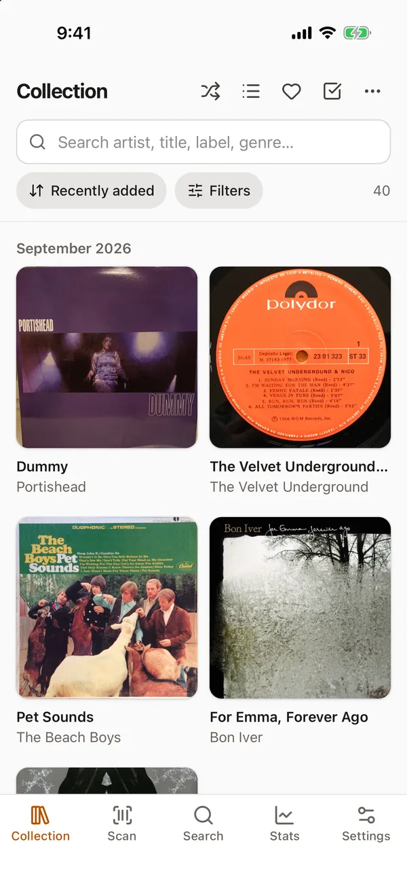
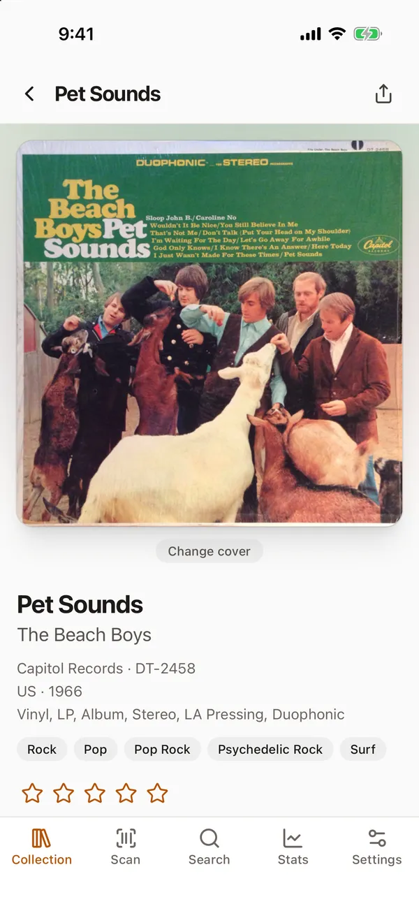
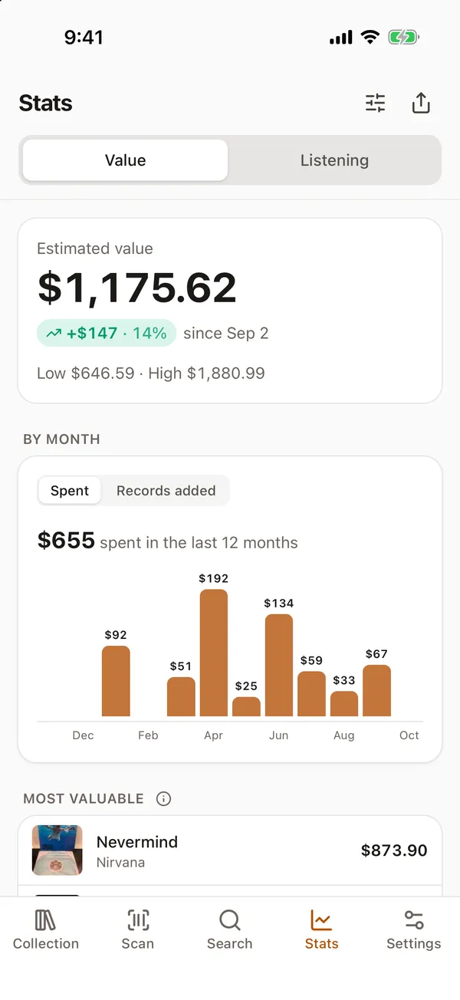
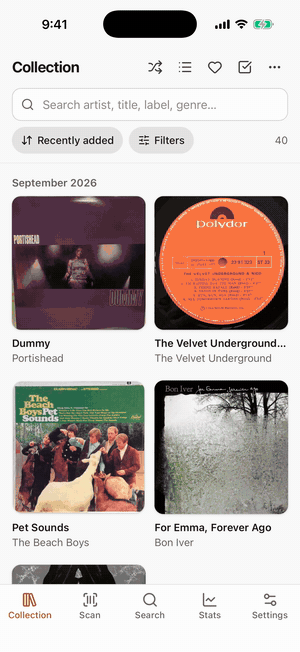

# Platter

Catalog your records on Discogs. Point your phone at a barcode and Platter finds the release and adds it to your collection. It also keeps track of what the collection is worth and what you play. Platter is a static web app you can install to your home screen. It talks to Discogs straight from your browser, and your Discogs sign-in stays on your device.

Live at [platter.tadinada.com](https://platter.tadinada.com), or [try the demo](https://platter.tadinada.com/?demo).

<p>
  
  
  
  
</p>

## What it does

- Browse your collection as a grid or list, and search across artist, title, label, genre, and your own notes
- Filter by crate (Discogs folders), format, genre, style, decade, rating, or any custom field, then sort or shuffle
- Record pages with tracklist, rating, crate, editable custom fields (price, dates, and play count get their own editors), barcodes and runouts, market prices, links to stream the album, and a choice of cover from the release's other Discogs photos
- Search results open a page for that release, laid out like a record page, where you can add it with its condition, price, store, date, location, and notes filled in, or put it on your wantlist
- In a batch, store, date, and location can be set once for every record. Purchase details without a field of their own go into Notes as a readable line
- Export any filtered view as a CSV in the same columns Discogs uses
- Stats tab with the collection's value from Discogs, with a daily reading kept on the device for a chart over time, what you paid next to what records go for now, your most valuable records, and sorting by value. Per-record prices use Discogs' suggested price for the copy's condition when seller settings are filled in, otherwise the lowest current listing. Prices refresh on their own in the background after each sync, at a pace that leaves room under the rate limit
- Scan a barcode with your phone camera, or type a barcode, catalog number, or artist and title
- Shows matching releases with cover, label, catalog number, country, year, and format, and can narrow them to ones you own, other pressings of ones you own, or new ones
- Warns if you already own that pressing, notes if you own another pressing of the same album, and flags wantlist hits (with an option to remove them after adding)
- Wantlist page, with each want opening its release page
- Falls back to MusicBrainz when Discogs doesn't know a barcode
- Tells pressings apart by the runout: type what's etched in the dead wax, or read it from a photo, and candidates are ranked against Discogs' Matrix / Runout data, allowing for lookalike characters (O/0, I/1, S/5, B/8) and partial transcriptions
- Reads catalog numbers off a photo of the spine
- Create, rename, and delete crates
- Batch mode: scan one record after another without stopping. Scans wait in an on-device queue that survives reloads and works offline, get looked up in the background, and are added together after a quick review
- Import a Discogs collection export (CSV) into your collection, with crates, conditions, notes, and ratings, for moving collections between accounts or sharing them
- Checks which Discogs custom collection fields you have and walks you through adding the rest
- Listening log: tap Log a play on a record, or scan it in Play mode, to bump its Play Count and Last Played fields. Every play is also kept on the device, with undo
- Listening stats: plays by month, most played, recently played, and records that haven't been on in a year
- The Value charts can be dragged into a different order or hidden (Edit on the Stats tab)
- Share on the Stats tab makes a picture of your collection's numbers to post or send
- Sort by most played, recently played, or location
- Optional ListenBrainz scrobbling: paste your token and each play is sent as the album's tracks
- Light, dark, or system theme, and a choice of accent color
- Streaming links: Apple Music and album.link (every service) for the exact album, looked up only when tapped, plus searches on Spotify and YouTube Music
- A demo with a sample collection, for trying it without a Discogs account

Text recognition runs on the device with Tesseract. Its engine and English data are served from Platter's own domain and only downloaded the first time they're used.

## How it works

Everything runs in the browser. There's no server-side database and no user accounts; Platter keeps its data in the browser's IndexedDB. API calls go directly from the browser to `api.discogs.com`, which allows cross-origin requests.

Other services are only contacted when they're needed: MusicBrainz and the Cover Art Archive when a barcode isn't on Discogs, Apple's iTunes Search API when you tap Apple Music or All services, and ListenBrainz if you connect it. The content security policy in `public/_headers` lists every host the app can talk to.

Two ways to sign in:

- **Log in with Discogs** (OAuth 1.0a). Discogs requires every request to be signed with the app's consumer secret, which can't ship to the browser. A small Cloudflare Worker (`worker/`) holds the secret and signs requests, including the two login steps. The browser sends every signed request to Discogs itself. The Worker never talks to Discogs, which matters because Discogs rate-limits by IP and Cloudflare's outgoing IPs are shared with everyone else's Workers. For the login steps the signature goes in the query string, since Discogs fails the CORS preflight on those two URLs.
- **Personal access token**. Pasted in once, kept in IndexedDB, no Worker involved.

The Worker rate-limits `/api/sign` per signed-in user (and the first login step per IP) using Cloudflare's built-in rate limiting.

Discogs counts rate limits per IP and doesn't expose its rate-limit headers to browsers, so the client throttles itself to 55 requests a minute and backs off on 429s. Cached Discogs data expires after 6 hours, per the Discogs API terms.

## Development

```sh
npm install
npm run dev        # app on http://localhost:5173
npm test           # unit tests, using recorded responses in tests/fixtures
npm run typecheck
```

`npm run dev` serves the app only, so log in with a personal access token locally. The signing route (`/api/sign`) only exists on the deployed Worker.

`/?demo` opens the demo. It keeps a sample collection in IndexedDB and answers collection, folder, and field calls locally; database lookups (search, releases, marketplace) go to Discogs unauthenticated, so search results come back without thumbnails.

To re-record test fixtures, put a token in `.env` (see `.env.example`) and run `npm run fixtures`. Your username and collection are replaced with placeholders before anything is written.

## Self-hosting

Platter runs on the Cloudflare Workers free plan.

1. Fork the repo and change the `routes` entry in `wrangler.jsonc` to your own domain, or remove it to use a `workers.dev` address.
2. Update `ALLOWED_ORIGINS` in `worker/index.ts` and the `og:` tags in `index.html` to match.
3. Register an app at [discogs.com/settings/developers](https://www.discogs.com/settings/developers) with the callback URL `https://<your domain>/auth/callback`.
4. Log in to Cloudflare and store the app's key and secret:

   ```sh
   npx wrangler login
   npx wrangler secret put DISCOGS_CONSUMER_KEY
   npx wrangler secret put DISCOGS_CONSUMER_SECRET
   ```

5. Deploy with `npm run deploy`.

Discogs doesn't allow "Discogs" in an app's name except as "<your name> for Discogs" (see their [Application Name and Description Policy](https://support.discogs.com/hc/en-us/articles/360009207054-Application-Name-and-Description-Policy)), so pick your own name when registering.

Skip steps 3 and 4 if you only want personal access tokens; the "Log in with Discogs" button won't work, but everything else will.

## License

MIT

This application uses Discogs’ API but is not affiliated with, sponsored or endorsed by Discogs. ‘Discogs’ is a trademark of Zink Media, LLC.
