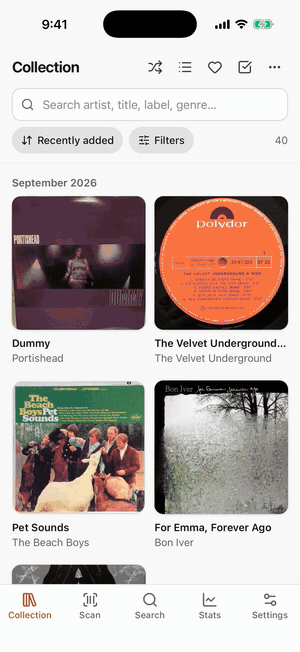
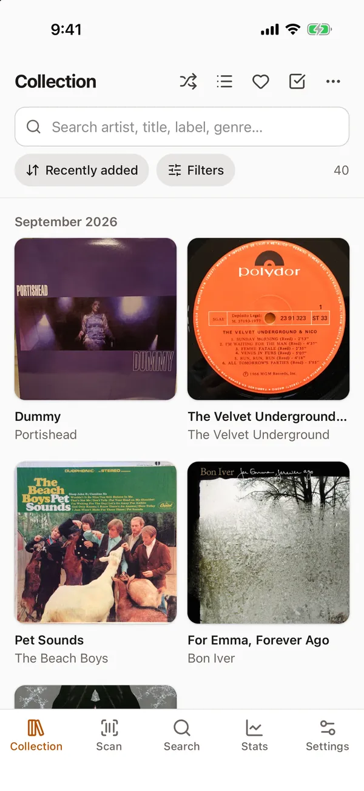
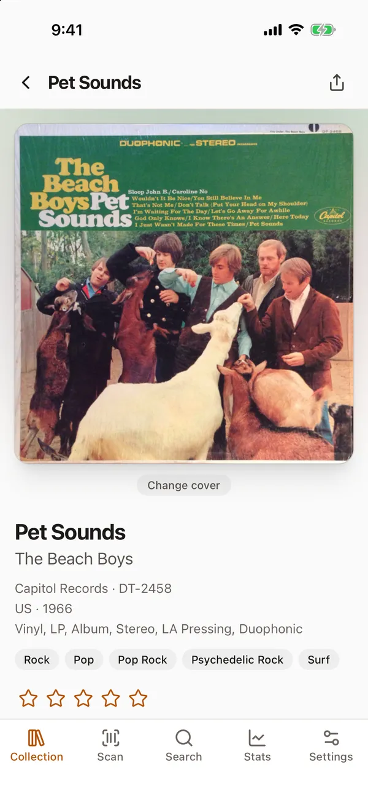
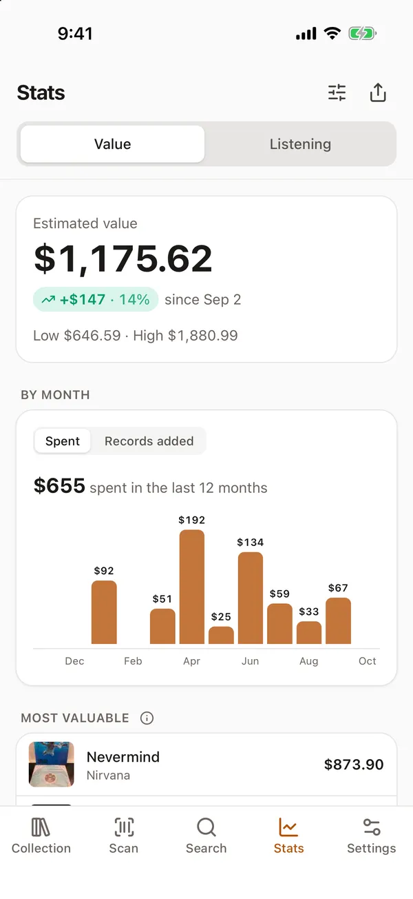
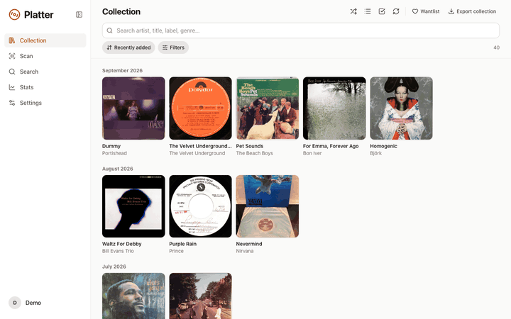
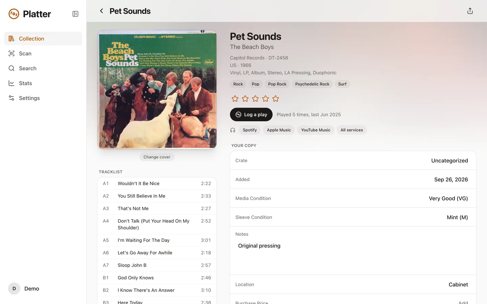
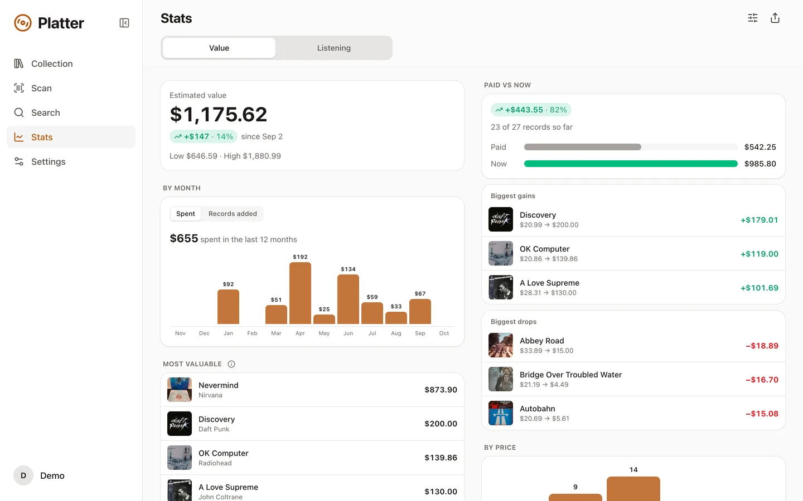
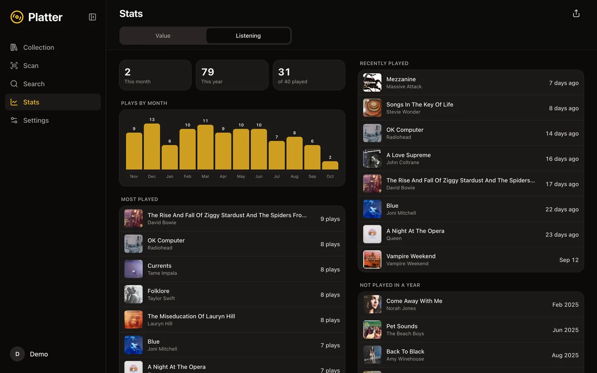

# Platter

Scan a record's barcode and add it to your Discogs collection. Platter also tracks what your records are worth and how often you play them. It's a web app you can install to your phone's home screen, and it talks to Discogs directly from your browser.

No Discogs account? [The demo](https://platter.tadinada.com/?demo) has a sample collection to poke around in.

<p>
  
  
  
  
</p>

<p>
  
  
  <br>
  
  
</p>

## Features

- **Scanning:** barcode by camera or photo, or search by catalog number or artist and title. Batch mode queues scans (offline too) and adds them all at once.
- **Pressings:** warns about duplicates and wantlist matches, and narrows down pressings by reading the runout or the spine.
- **Collection:** grid or list, search, filters, sort, crates, and custom fields like condition, price, and location.
- **Value:** Discogs prices per record, value over time, paid vs. now, and charts you can rearrange.
- **Listening:** log plays, see what you play most and what you haven't touched in a year, and optionally scrobble to ListenBrainz.
- **Import and export:** Discogs CSVs in and out, plus a backup of everything Platter keeps locally.
- **Platter account:** optional. Syncs your plays and settings between devices, and gives you a profile you can share and people to follow.

## How it works

Without a Platter account, everything stays in your browser and the app calls `api.discogs.com` directly. "Log in with Discogs" uses OAuth, which needs the app secret, so a small Cloudflare Worker (`worker/`) signs each request. To sign, it gets your OAuth token and token secret and the URL being requested. It doesn't store or log them, and Discogs' responses go straight to your browser. Personal access tokens don't need signing.

### What a Platter account keeps on the server

The account lives in a Cloudflare D1 database:

- **Sign-in:** your Discogs username and user ID, a hash of your password's proof (the password is stretched in the browser and never sent), passkeys' public keys, and each device's name, type, and when it was last seen. Device keys and pairing codes are stored as hashes.
- **Synced data:** plays, value history, covers you picked, the Batch queue, settings, and album years, record lengths, and barcodes. ListenBrainz tokens are encrypted. Switching a category off deletes it from the server.
- **Profile:** private until you change it. It holds what you choose to show (collection, wantlist, stats, bio, setup, links, location, pronouns), plus who you follow and block. Ratings and other fields of your copies only show if you pick them.

To confirm a new account or device belongs to your Discogs account, the Worker asks Discogs who you are through [Browser Run](https://developers.cloudflare.com/browser-rendering/), since Discogs blocks Cloudflare's own servers. That's the only time a personal access token reaches the server, and nothing from the check is kept but your username and user ID.

Deleting your account removes all of it. Cloudflare keeps point-in-time restores of the database for 7 days on the free plan (30 on paid), so deleted data is gone for good after that.

Whoever runs a copy can read its database (apart from the encrypted tokens). In the app, admins see each member's name, sign-in methods, devices, and last visit, and can hide a profile, reset someone's sign-in, or delete an account.

### Other services

Platter also uses [MusicBrainz](https://musicbrainz.org) and the [Cover Art Archive](https://coverartarchive.org) for barcodes Discogs doesn't know, Apple's search to find albums for the streaming links, and [ListenBrainz](https://listenbrainz.org) if you connect it. Photos of barcodes, runouts, and spines are read on the device with [ZXing](https://github.com/zxing-cpp/zxing-cpp) and [Tesseract](https://github.com/naptha/tesseract.js), and never uploaded.

## Development

```sh
npm install
npm run dev    # http://localhost:5173
npm test
```

Locally, sign in with a personal access token or open `/?demo`. To re-record test fixtures, put a token in `.env` (see `.env.example`) and run `npm run fixtures`.

For Platter accounts, put a `SYNC_KEY` in `.dev.vars`, run `npx wrangler d1 migrations apply platter --local`, then `npx wrangler dev --port 8787` next to `npm run dev`. Vite sends `/api` to it.

## Self-hosting

It runs on the Cloudflare Workers free plan. Everything you set up lives in `wrangler.jsonc`, and the app's build reads it too.

### Just you

Your collection, prices, plays, and stats, kept in your browser. No database.

1. In `wrangler.jsonc`, point `routes` at your domain and set `SITE` under `vars` to its address (`https://records.example.com`).
2. Remove the `d1_databases` and `browser` entries. The app leaves out Platter accounts when there's no database.
3. Register an app at [discogs.com/settings/developers](https://www.discogs.com/settings/developers) with the callback `https://<your domain>/auth/callback`. Discogs doesn't allow "Discogs" in app names except as "<name> for Discogs".
4. Store its key and secret with `npx wrangler secret put DISCOGS_CONSUMER_KEY` and `npx wrangler secret put DISCOGS_CONSUMER_SECRET`.
5. `npm run deploy`

Skip 3 and 4 if you only sign in with a personal access token.

### With Platter accounts

Sync between devices, profiles, and following, for you and anyone using your copy. Accounts live on your server only, so they can't follow people on another copy. Do the steps above, but keep `browser` and set up the database instead of removing it:

1. `npx wrangler d1 create platter`, and put the `database_id` it prints in `wrangler.jsonc`.
2. `npx wrangler d1 migrations apply platter --remote`, and again after updates that add migrations.
3. `openssl rand -base64 32 | npx wrangler secret put SYNC_KEY`. It encrypts secrets kept on the server, like ListenBrainz tokens, so don't change it later.
4. `npm run deploy`

Discogs turns away requests from Cloudflare's servers, so accounts check Discogs logins through [Browser Run](https://developers.cloudflare.com/browser-rendering/). The free plan's 10 minutes a day is plenty for a small group. To make yourself an admin, sign in once, then run `npx wrangler d1 execute platter --remote --command "UPDATE accounts SET admin = 1 WHERE name = '<your Discogs username in lowercase>'"`.

## License

MIT

This application uses Discogs’ API but is not affiliated with, sponsored or endorsed by Discogs. ‘Discogs’ is a trademark of Zink Media, LLC.
