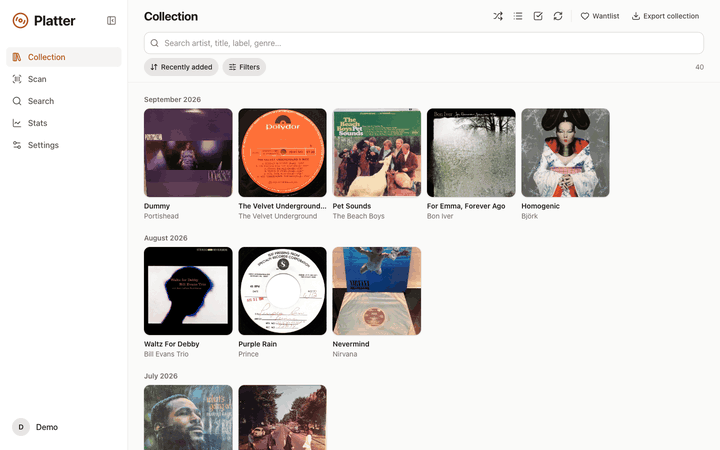
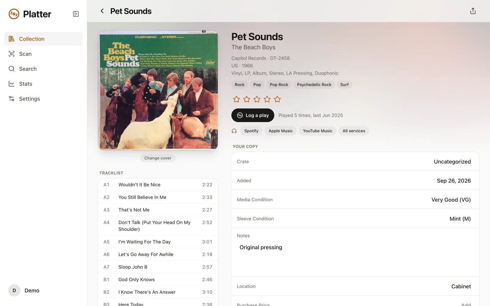
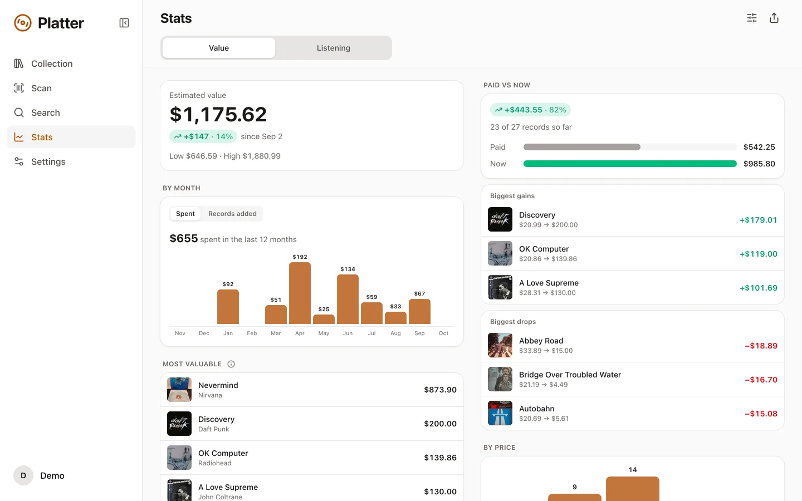
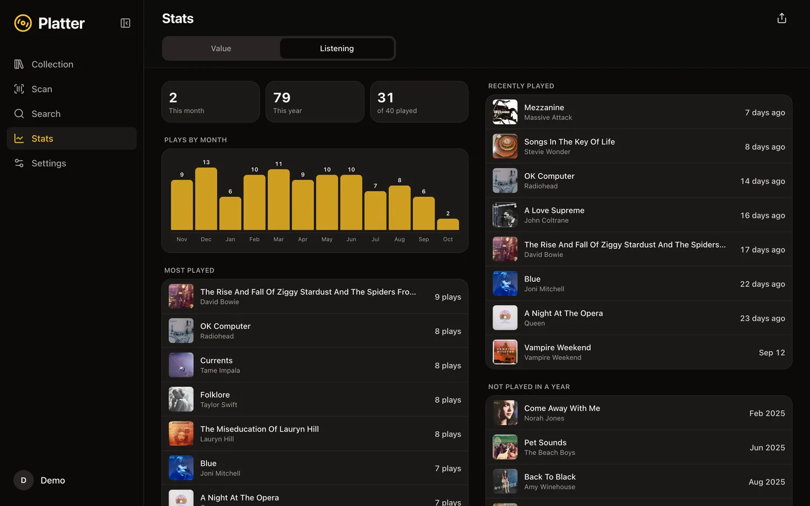

# Platter

Scan a record's barcode and add it to your Discogs collection. Platter also tracks what your records are worth and how often you play them. It's a web app you can install to your phone's home screen, and it talks to Discogs directly from your browser.

No Discogs account? [The demo](https://platter.tadinada.com/?demo) has a sample collection to poke around in.

<p>
  
  
  
  
</p>

<p>
  
  
  <br>
  
  
</p>

## Features

- **Scanning:** barcode by camera or photo, or search by catalog number or artist and title. Batch mode queues scans (offline too) and adds them all at once.
- **Pressings:** warns about duplicates and wantlist matches, and narrows down pressings by reading the runout or the spine.
- **Collection:** grid or list, search, filters, sort, crates, and custom fields like condition, price, and location.
- **Value:** Discogs prices per record, value over time, paid vs. now, and charts you can rearrange.
- **Listening:** log plays, see what you play most and what you haven't touched in a year, and optionally scrobble to ListenBrainz.
- **Import and export:** Discogs CSVs in and out, plus a backup of everything Platter keeps locally.

## How it works

There's no backend database. Platter stores its data in the browser and calls `api.discogs.com` directly. "Log in with Discogs" uses OAuth, and a small Cloudflare Worker (`worker/`) signs requests with the app secret without ever seeing your data. Personal access tokens skip the Worker entirely.

Platter also uses [MusicBrainz](https://musicbrainz.org) and the [Cover Art Archive](https://coverartarchive.org) for barcodes Discogs doesn't know, Apple's search to find albums for the streaming links, and [ListenBrainz](https://listenbrainz.org) if you connect it. Photos of runouts and spines are read on the device with [Tesseract](https://github.com/naptha/tesseract.js).

## Development

```sh
npm install
npm run dev    # http://localhost:5173
npm test
```

Locally, sign in with a personal access token or open `/?demo`. To re-record test fixtures, put a token in `.env` (see `.env.example`) and run `npm run fixtures`.

## Self-hosting

It runs on the Cloudflare Workers free plan.

1. Point `routes` in `wrangler.jsonc` at your domain, and update `ALLOWED_ORIGINS` in `worker/index.ts` and the `og:` tags in `index.html`.
2. Register an app at [discogs.com/settings/developers](https://www.discogs.com/settings/developers) with the callback `https://<your domain>/auth/callback`. Discogs doesn't allow "Discogs" in app names except as "<name> for Discogs".
3. Store the key and secret with `npx wrangler secret put DISCOGS_CONSUMER_KEY` and `DISCOGS_CONSUMER_SECRET`.
4. `npm run deploy`

Skip 2 and 3 if you only need personal access tokens.

## License

MIT

This application uses Discogs’ API but is not affiliated with, sponsored or endorsed by Discogs. ‘Discogs’ is a trademark of Zink Media, LLC.
